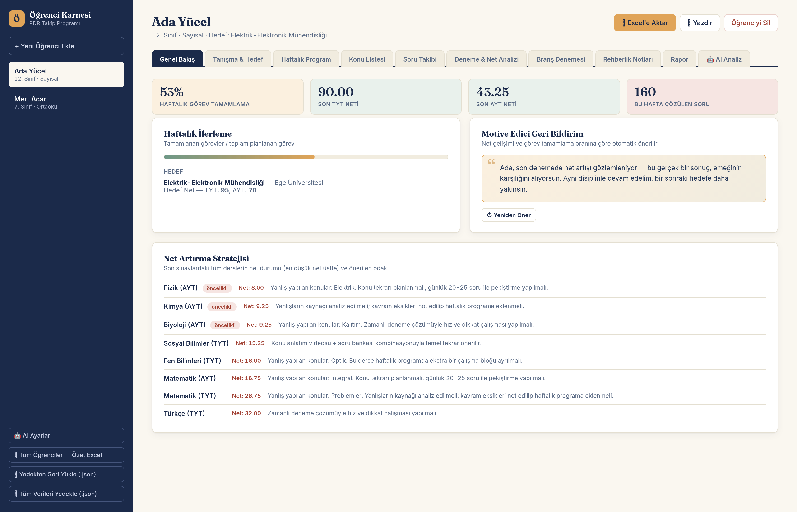
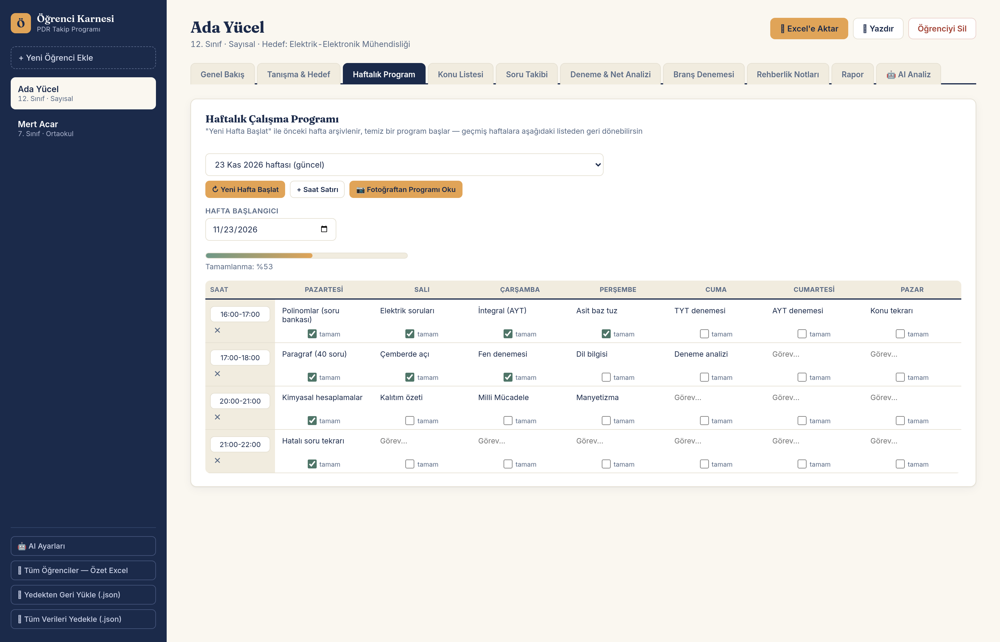
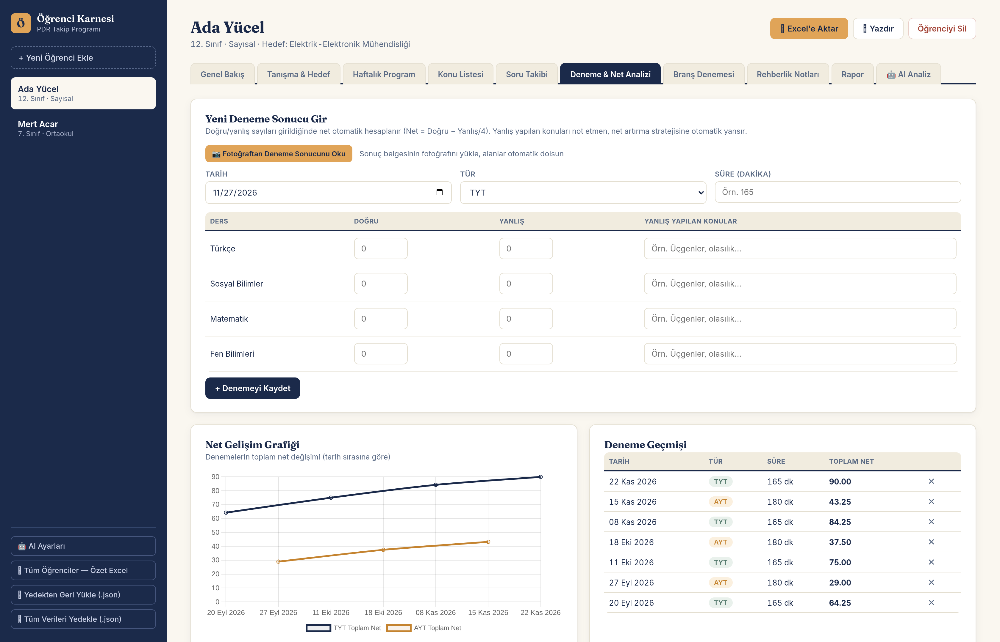
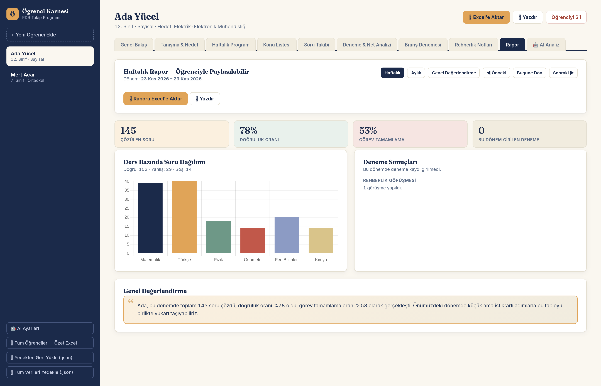
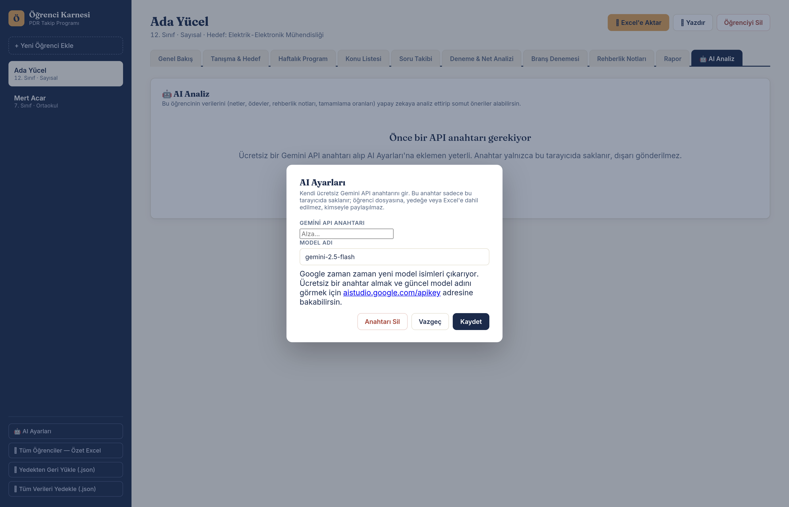

# Öğrenci Karnesi — PDR Takip Programı

Bir PDR arkadaşım, öğrencilerin haftalık takiplerini WhatsApp üzerinden yürütmekten kurtulmak istiyordu. Sunuculu ya da kurulumu ağır bir program istemedi; haftalık takibi düzenli tutacak, mümkünse yapay zeka ile de desteklenecek hafif bir araç istedi. Ben de bunu tek bir HTML dosyası ve Google Gemini API ile çözdüm.

Program tarayıcıda açılıyor. Öğrenci dosyaları bu bilgisayarın tarayıcısında duruyor; bir sunucuya gitmiyor. Yedekleme JSON dosyalarıyla yapılıyor, bu yüzden veriler kullanıcının elindeki yedekte duruyor.

Ekran görüntülerindeki öğrenciler ve notlar tamamen örnek kayıtlardır. Gerçek öğrenci verisi bu depoda yoktur.

## Ne işe yarar

Lise ve ortaokul öğrencileri için ayrı takip ekranları var. Lisede TYT/AYT netleri, konu listesi, soru ve deneme takibi öne çıkıyor. Ortaokulda ise ödev teslimi, veli bilgisi ve deneme takibi daha sade tutulmuş. Her iki kademede de haftalık program, rehberlik notları ve Gemini ile analiz bulunuyor.

Amaç, görüşmede konuşulanları, evde çözülen soruları ve deneme sonuçlarını dağınık mesajların içinde kaybetmeden, tek bir öğrenci dosyasında biriktirmek.

## Özellikler

### Lise öğrencileri (9-12 ve mezun)

- **Genel bakış.** Haftalık görev tamamlama oranı, son TYT ve AYT neti, bu hafta çözülen soru sayısı. Net gelişimine ve görev tamamlama oranına göre otomatik, motive edici bir geri bildirim metni üretilir. Son denemelerdeki ders netleri düşükten yükseğe sıralanır ve net artırma stratejisi önerilir.
- **Tanışma ve hedef.** Ad, sınıf, alan (Sayısal, Eşit Ağırlık, Sözel, YDT), hedef üniversite, hedef bölüm, hedef TYT ve AYT neti kaydedilir.
- **Haftalık çalışma programı.** Günlere ve saat dilimlerine göre görev yazılır, tamamlananlar işaretlenir. "Yeni Hafta Başlat" önceki haftayı arşivler; geçmiş haftalara listeden geri dönülebilir.
- **Konu listesi.** Konular tek tek işaretlenerek ilerleme tutulur. Sayısal ve sözel alanlar için hazır TYT/AYT konu setleri tek tuşla yüklenebilir; mevcut kayıtların üzerine yazılmaz. İstenirse ders ve konu elle de eklenir.
- **Soru takibi.** Tarih, ders, konu, kaynak, doğru/yanlış/boş ve süre girilir. Ders bazında dağılım pasta grafikte görünür.
- **Deneme ve net analizi.** TYT ve AYT sonuçları ders ders kaydedilir. Net, doğru eksi yanlışın dörtte biri olarak hesaplanır. Tarihe göre net grafiği çizilir; zayıf konular not edilebilir.
- **Branş denemesi.** Tek derslik denemeler (süre, doğru/yanlış/boş, konular) tutulur ve ders bazında ortalama net çubuk grafikte gösterilir.
- **Rapor.** Haftalık, aylık (son bir aylık kayan pencere) veya genel değerlendirme. Dönem içindeki soru sayısı, doğruluk oranı, görev tamamlama ve deneme özeti yer alır. Ders bazında soru dağılımı grafiği vardır. Rapor Excel'e aktarılabilir veya yazdırılabilir; öğrenciyle paylaşılacak şekilde hazırlanmıştır. Raporda o dönemdeki rehberlik görüşmesi sayısı görünür, görüşme notlarının ayrıntısı yer almaz.

### Ortaokul öğrencileri (5-8)

- **Genel bakış.** Öğrenci ve veli bilgisi, ödev tamamlama oranı, bekleyen ve süresi geçen ödev sayısı, son deneme neti.
- **Haftalık ders programı.** Lisedekiyle aynı yapı, daha sade kullanım için.
- **Ödev takip.** Ders, verilme ve teslim tarihi, açıklama. Tamamlananlar işaretlenir; teslim tarihi geçen ödevler listede belirtilir.
- **Deneme takibi.** Ders, doğru/yanlış/boş, konu ve net kaydı. Ders bazında ortalama net grafiği vardır.

### Her iki kademede ortak

- **Rehberlik notları.** Tarih, konu başlığı ve görüşme notu eklenir; geçmiş kayıtlar öğrencinin dosyasında tutulur.
- **AI analiz.** Kullanıcının kendi Gemini API anahtarıyla çalışır. Varsayılan model `gemini-2.5-flash` olsa da model adı değiştirilebilir. "Hızlı Analiz Oluştur", öğrencinin kayıtlı verilerinden genel durum, güçlü yönler, dikkat edilecekler ve somut aksiyon önerileri ister. Serbest soru da yazılabilir. Asistan; tıbbi veya psikolojik teşhis koymaması, çalışma programı, ders/konu odağı, motivasyon ve veli iletişimi için pratik öneri vermesi üzere yönlendirilmiştir. Sohbet yalnızca o oturumda tutulur, yedeğe yazılmaz. İstenirse bir yanıt rehberlik notu olarak kaydedilebilir.
- **Fotoğraftan okuma.** Haftalık program, lise deneme sonucu, soru kaydı ve ortaokul deneme sonucu fotoğraftan okunabilir. Okunan veri kaydedilmeden önce kontrol ve onay istenir. Bunun için de aynı Gemini anahtarı kullanılır.
- **Excel ve yazdırma.** Açık öğrencinin karnesi Excel'e aktarılabilir (program, soru, deneme, branş, konu listesi ve notlar ayrı sayfalarda). Tüm öğrenciler için özet bir Excel de çıkarılabilir. Sayfa yazdırılabilir; yazdırmada yan menü ve düğmeler gizlenir.
- **Yedekleme.** Tüm öğrenci dosyaları bir JSON dosyasına indirilir ve aynı dosyadan geri yüklenir. Geri yükleme, mevcut verinin üzerine yazar ve bunu onaylattırır.

## Nasıl kullanılır

1. `index.html` dosyasını bir tarayıcıda aç. Kurulum, sunucu veya hesap gerekmez. İstersen dosyayı daha sonra GitHub Pages ile de yayınlayabilirsin; veri yine her kullanıcının kendi tarayıcısında kalır.
2. Soldan "Yeni Öğrenci Ekle" ile lise veya ortaokul dosyası oluştur.
3. Yapay zeka ve fotoğraftan okuma için soldaki "AI Ayarları"na gir. Ücretsiz bir Gemini anahtarını [Google AI Studio](https://aistudio.google.com/apikey) üzerinden alıp yapıştır. Anahtar yalnızca bu tarayıcıda saklanır. İstediğin zaman "Anahtarı Sil" ile kaldırabilirsin.
4. Düzenli olarak "Tüm Verileri Yedekle" ile JSON al. Başka bir tarayıcıya veya bilgisayara geçerken "Yedekten Geri Yükle" yeter.

## Gizlilik

Öğrenci dosyaları bu programın bir sunucusuna gitmez; böyle bir sunucu yoktur. Kayıtlar tarayıcının `localStorage` alanında durur. Yedek dosyası da senin indirdiğin JSON'dur, onu nerede tutacağın sana kalır.

API anahtarı öğrenci verisinden ayrı saklanır. Yedek JSON'a, öğrenci karnesine veya özet Excel'e dahil edilmez.

Buna karşılık AI analiz veya fotoğraftan okuma kullanıldığında, o istek Google Gemini API'sine gider. Analizde öğrencinin adı, takip özeti ve varsa son rehberlik notları; fotoğraf okumada da yüklenen görüntü gönderilir. Bu yüzden anahtarı yalnızca güvendiğin bir tarayıcıda kullanman ve yedek dosyasını başkasıyla paylaşmaman gerekir.

Bu depoyu hazırlarken dosyada sabit bir API anahtarı, gerçek öğrenci adı, telefon, e-posta veya görüşme kaydı olup olmadığı tarandı. Böyle bir veri yoktu; anahtar zaten kullanıcı tarafından girilecek şekilde yazılmıştı.

## Kullanılan teknolojiler

- Tek bir HTML dosyası (HTML, CSS, JavaScript)
- [Chart.js](https://www.chartjs.org/) 4.5.1 (grafikler)
- [SheetJS](https://sheetjs.com/) (xlsx) 0.18.5 (Excel aktarımı)
- Google Gemini API (metin analizi ve görüntüden okuma)
- Tarayıcı `localStorage` (yerel kayıt)

Dosyaya gömülü kütüphaneler MIT lisanslıdır. Çevrimiçi olarak yalnızca yazı tipleri (Fraunces ve Inter, Google Fonts) ve, anahtar girildiyse, Gemini API çağrıları kullanılır.

## Ekran görüntüleri

Örnek verilerle alınmış görüntüler:

## Lisans

MIT. Ayrıntılar `LICENSE` dosyasındadır.
